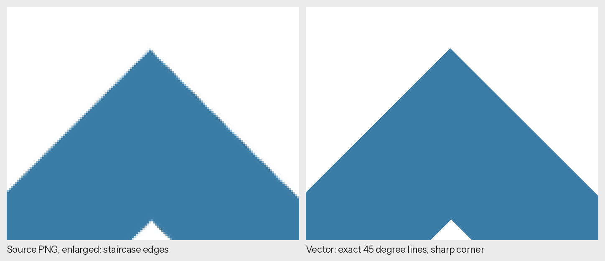
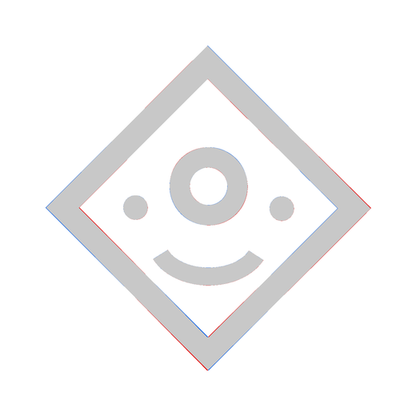
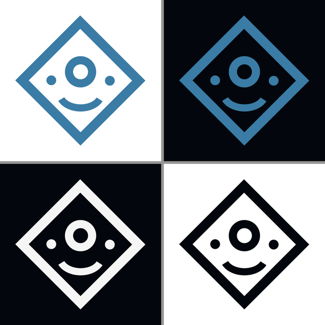
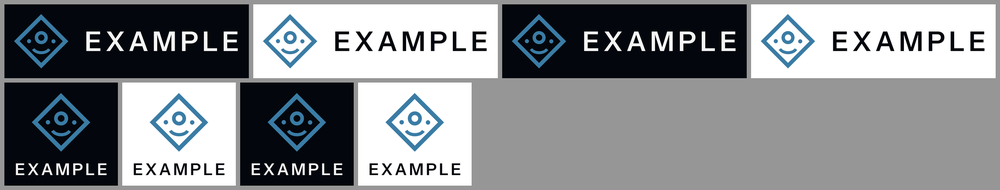
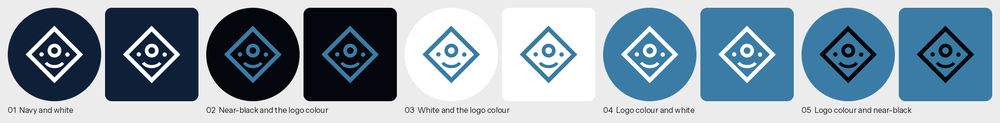
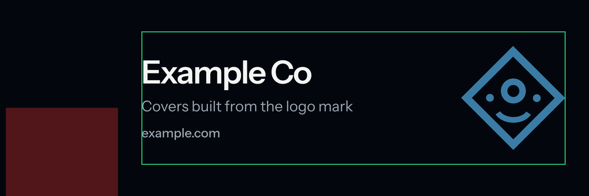
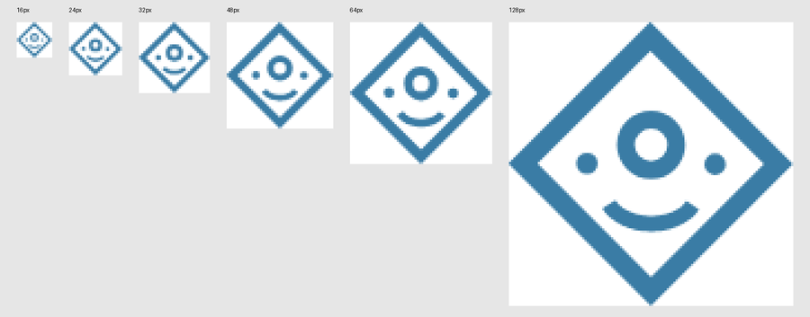

# logo-repolish

Rebuild an existing logo as a precise vector and export a complete brand kit from it, entirely on your own
machine.

By [Ali Raza](https://github.com/ali-raza-arain). MIT License.

logo-repolish is an agent skill for Claude Code (and any agent that reads `SKILL.md` skill folders), plus a set of
standalone Python tools you can run yourself. Give it a PNG of your logo and it returns:

- a master SVG with exactly straight lines, sharp corners and true circles;
- a check against the source and a design audit;
- every format and theme the logo needs, for screens and for print;
- name lockups, favicons and app icons, profile pictures and social covers.



*Every image in this README comes from a made-up demo mark ([examples/](examples/)), never from a real brand.*

## Contents

- [What it does](#what-it-does)
- [How it differs from auto-trace](#how-it-differs-from-auto-trace)
- [Install](#install)
- [First run](#first-run)
- [Using it with Claude](#using-it-with-claude)
- [Using the tools directly](#using-the-tools-directly)
- [What you get](#what-you-get)
- [Privacy](#privacy)
- [Requirements](#requirements)
- [Limitations](#limitations)
- [Documentation](#documentation)
- [Contributing](#contributing)
- [Author](#author)
- [License and credits](#license-and-credits)

## What it does

| Step | Tool | Result |
|---|---|---|
| Rebuild | `vectorize.py` | master SVG in the source's own pixel units, one path per colour, holes as even-odd subpaths |
| Check | `compare.py` | how much ink differs from the source, a difference map and close-ups of the worst spots |
| Audit | `audit.py` | stroke weights, gaps, holes, off-grid angles, near-alignments, a 16 to 128 px legibility sheet |
| Kit | `export_kit.py` | SVG and PDF, transparent PNG 256 to 4096 px, light and dark PNG and JPG, one-colour versions, favicon.ico |
| Lockups | `lockups.py` | mark with the brand name set as vector outlines from a real font, horizontal and stacked |
| Icons | `icons.py` | favicon.svg, favicon PNG and ICO, apple-touch-icon, manifest and maskable icons, plus the head tags |
| Profiles | `profiles.py` | circle-safe profile pictures in restrained professional palettes, with a labelled preview sheet |
| Covers | `covers.py` | LinkedIn, X, Facebook and YouTube covers with each platform's safe area and a guide image |
| Upscale | `upscale.py` | 4x Real-ESRGAN for 3D or metallic raster logos, blended so flat areas stay clean |

The skill wraps these tools in a careful workflow: it asks for the best source, checks every result by looking
at it, reports what it found in plain words, and changes the shape or colours of a logo only when the owner
agrees.

## How it differs from auto-trace

A generic tracer reproduces pixels: the antialiasing staircase, the slight bow in a line from an image
generator, the rounded tip of what should be a sharp corner. `vectorize.py` rebuilds the geometry instead:

- edges are read at sub-pixel precision from the antialiased image;
- stretches that run near a multiple of 45 degrees (or 30, or 15) become exact straight lines, fitted over their
  whole length, so a line that bows by a pixel comes out straight;
- lines meet at their exact intersection, and the bitmap's rounding of a corner is dropped;
- curves are smoothed and eased onto the neighbouring lines, so there are no steps;
- round holes and dots become exact circles, and circles of nearly the same size are made identical.

On the demo mark the vector and the source differ on under 2% of the ink pixels, nearly all of them antialiased
edge pixels:



The details are in [docs/how-it-works.md](docs/how-it-works.md).

## Install

### Option 1: Claude Code plugin

Inside Claude Code:

```
/plugin marketplace add ali-raza-arain/logo-repolish-skill
/plugin install logo-repolish@logo-repolish
```

The skill is then available in every project. Claude loads it on its own when you ask for logo work, or you can
ask for it by name.

### Option 2: copy the skill folder

```bash
git clone https://github.com/ali-raza-arain/logo-repolish-skill.git
cp -r logo-repolish-skill/skills/logo-repolish ~/.claude/skills/        # for all your projects
# or, for one project only:
cp -r logo-repolish-skill/skills/logo-repolish /path/to/project/.claude/skills/
```

Other agents that support `SKILL.md` skill folders can use the same folder; see their documentation for where
skills live.

### Option 3: upload as a ZIP

```bash
python tools/package_skill.py        # writes dist/logo-repolish.zip
```

Upload the ZIP where your Claude app lets you add a skill. Note that the tools render with a local Chromium and
install Python packages on first use. They were built and tested for local agents such as Claude Code; a hosted
sandbox may not allow that setup.

## First run

The tools need a few Python packages and a headless Chromium. One command installs them into a private virtual
environment at `~/.cache/logo-repolish` (nothing system-wide):

```bash
bash skills/logo-repolish/scripts/setup_env.sh              # core tools and Chromium, a few hundred MB
bash skills/logo-repolish/scripts/setup_env.sh --upscale    # optional: PyTorch CPU and the upscaler model
```

When you use the skill through Claude, Claude runs this for you the first time. To check everything works:

```bash
~/.cache/logo-repolish/venv/bin/python tests/smoke_test.py
```

## Using it with Claude

Put your logo file in the project, then ask in your own words. For example:

- "Here is our logo, `brand/logo.png`. Make it a clean vector and tell me if anything is off."
- "From `brand/logo.svg`, make a full kit: light and dark versions, transparent PNGs and a PDF for the printer."
- "Make favicons and app icons for the website from our logo and update the head tags."
- "Make profile pictures from the logo in a few professional colour schemes so I can choose."
- "Make a LinkedIn company cover with the headline 'Field service software' and our site example.com."
- "Our logo is a 3D gold render at 1024 px. Make an HD version without ruining the shine."

What to expect: Claude asks for the best source and the official colour if it is unclear, builds the vector,
shows you the comparison and the audit findings, and asks before changing anything about the design. Each kit
step writes to a new folder and ends with a preview image for you to check. The full walkthrough, with what
Claude looks for at each step, is in [docs/guide.md](docs/guide.md).

## Using the tools directly

Every tool is a plain command-line script. With the environment from the setup:

```bash
PY=~/.cache/logo-repolish/venv/bin/python
S=skills/logo-repolish/scripts

$PY examples/make_demo_logo.py work/demo.png                      # or use your own logo
$PY $S/vectorize.py work/demo.png work/logo.svg --title "Example"
$PY $S/compare.py   work/demo.png work/logo.svg work/check
$PY $S/audit.py     work/logo.svg work/audit
$PY $S/export_kit.py work/logo.svg --out kit/logo --name example
$PY $S/lockups.py   work/logo.svg --out kit/lockup --text "EXAMPLE"
$PY $S/icons.py     work/logo.svg --out kit/icons
$PY $S/profiles.py  work/logo.svg --out kit/profiles
$PY $S/covers.py    work/logo.svg --out kit/covers --headline "Example Co" --url example.com
```

Every option of every script is listed in [docs/cli.md](docs/cli.md).

## What you get

The kit preview (the logo colour on white and on near-black, then the one-colour versions):



Lockups with the name set from a real font:



Profile pictures, each shown as a circle and as a rounded square:



A LinkedIn company cover, and the guide image for an X header (green: safe area, red: where the profile photo
sits):




The audit's small-size sheet, for judging favicon legibility:



A full kit folder looks like this:

```
kit/
  logo/       svg/  pdf/  png/transparent/  png/light/  png/dark/  png/one-colour/  jpg/  ico/  preview.png
  lockup/     svg/  pdf/  png/  jpg/  preview.png
  icons/      favicon.svg  favicon-32.png  favicon-48.png  favicon.ico  apple-touch-icon.png
              icon-192.png  icon-512.png  icon-maskable-512.png  logo-512.png
  profiles/   <name>-NN-<palette>.svg / -1080.png / -1080.jpg / -400.png, preview-all.png
  covers/     <name>-<platform>-<size>.png / .jpg, <name>-<platform>-guides.png
```

## Privacy

Logos are often unreleased or confidential, so the tools are built to keep them on your machine:

- all processing and rendering is local; no tool sends your logo anywhere;
- the skill tells the agent never to upload the logo to websites, image generators, design tools or storage;
- the only network use is the one-time setup: Python packages from PyPI, Chromium from Playwright's servers and,
  with `--upscale`, PyTorch from pytorch.org and the model file from the Real-ESRGAN GitHub releases.

When you report a bug, please use the demo mark or a logo you are free to share.

## Requirements

- Python 3.10 or newer.
- Linux or macOS. On Windows, use WSL, or install `requirements.txt` with pip and run
  `python -m playwright install chromium`.
- A few hundred MB of disk for Chromium; about 1 GB more for the optional upscaler.
- A normal laptop is enough. The upscaler runs on the CPU and takes a few minutes for a 1024 px image.

## Limitations

- `vectorize.py` is for flat logos: solid colours with sharp or antialiased edges. It does not vectorize
  gradients, 3D renders, photos or textures. For those, see [references/3d-logos.md](skills/logo-repolish/references/3d-logos.md).
- Curves are written as dense straight segments (within 0.08 source px of the smoothed edge), not Bezier curves.
  They render perfectly at any size, but editing a curve by hand in a design tool means many anchor points.
- Text inside a logo is traced as shapes. If you know the font, setting the name with `lockups.py` is cleaner.
- Strokes thinner than about 2 px in the source, and colours that blend into each other, may need a larger source
  or the `--colors` and `--background` options.
- The audit measures; it does not judge intent. A deliberate optical adjustment can look like an inconsistency.
- Platform sizes for covers and profiles change from time to time. They are kept in one table in `covers.py`
  and documented in [references/platform-sizes.md](skills/logo-repolish/references/platform-sizes.md).

## Documentation

- [docs/guide.md](docs/guide.md): a full walkthrough, from the source file to a website using the new kit.
- [docs/cli.md](docs/cli.md): every script and option.
- [docs/how-it-works.md](docs/how-it-works.md): the methods behind the vectorizer, the audit and the exports.
- [docs/troubleshooting.md](docs/troubleshooting.md): common problems and fixes.
- [skills/logo-repolish/SKILL.md](skills/logo-repolish/SKILL.md): the instructions the agent follows.
- [references/design-rules.md](skills/logo-repolish/references/design-rules.md): what makes a mark well built.

## Contributing

Issues and pull requests are welcome. Please read [CONTRIBUTING.md](CONTRIBUTING.md) first; in short, run the
smoke test, keep the tools local-only, and attach only images you are free to share.

## Author

logo-repolish is written and maintained by Ali Raza ([github.com/ali-raza-arain](https://github.com/ali-raza-arain)).
If it saves you time, a star on the repository helps others find it.

## License and credits

Copyright (c) 2026 Ali Raza. The code and documentation are under the [MIT License](LICENSE).

The bundled font, Instrument Sans, is by the Instrument Sans Project Authors under the SIL Open Font License 1.1
([its license](skills/logo-repolish/assets/fonts/OFL.txt)). The optional upscaler uses the Real-ESRGAN x4plus
model by Xintao Wang and contributors (BSD 3-Clause), downloaded during setup and loaded with spandrel. Other
dependencies are listed in [THIRD_PARTY_NOTICES.md](THIRD_PARTY_NOTICES.md).
